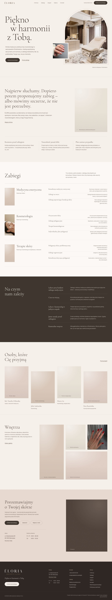

# ÉLORIA Aesthetic Medical Clinic – strona internetowa

Strona fikcyjnej kliniki medycyny estetycznej z Warszawy. Hasło marki: *Piękno w harmonii z Tobą.*

> **Projekt demonstracyjny agencji ComputerIT.** Adres, telefon, e-mail, zespół, godziny otwarcia oraz opisy procedur
> i kwalifikacji są przykładowe. Treści medyczne wymagają weryfikacji przez personel medyczny kliniki przed publikacją.



## Stack

- **Next.js 16** (App Router, Turbopack, Server Actions), **React 19**, **TypeScript**
- **Tailwind CSS 4** – tokeny kolorów, typografii i komponentów w `src/app/globals.css`
- **next/font** – Cormorant Garamond (nagłówki) i Manrope (tekst, interfejs), serwowane z własnego serwera
- **next/og** – grafiki Open Graph generowane z logo i krojów marki (`@fontsource`)
- **Vitest** – testy walidacji formularzy

## Uruchomienie

```bash
cd eloria
npm install
npm run dev            # http://localhost:3000
```

Kontrole jakości:

```bash
npm run lint && npm run typecheck && npm test && npm run build
```

## Struktura

```
src/
  app/                       podstrony: /, /o-klinice, /zabiegi, /zabiegi/[slug], /zespol, /galeria,
                             /kontakt, /rezerwacja, /polityka-prywatnosci, 404, sitemap, robots, OG
    actions.ts               Server Actions formularzy (walidacja serwerowa, limit prób, pole-pułapka)
  config/site.ts             ★ dane kliniki, kontakt, godziny, nawigacja
  config/images.ts           ★ shot list: plik → miejsce na stronie, alt, proporcje, brief dla fotografa
  data/services.ts           ★ kategorie i 10 zabiegów (opis, przebieg, wskazania, przeciwwskazania, kwalifikacja)
  data/team.ts, gallery.ts   zespół (osoby fikcyjne), układ galerii
  lib/validation.ts          walidacja wspólna dla przeglądarki i serwera
  lib/server/                wysyłka webhookiem, limit prób, grafiki OG
  components/                layout, sekcje strony głównej, formularze, galeria, UI
public/brand/                logo klienta: napis, monogram, pełny znak (wersje jasne i ciemne, przezroczyste tło)
public/images/eloria/        zdjęcia
docs/screenshots/            zrzuty ekranu (desktop i mobile)
```

## System wizualny

| Token | Kolor | Zastosowanie |
| --- | --- | --- |
| Ivory | `#F5F0E9` | tło strony |
| Blush | `#E7D8D0` | sekcje kontaktu, panele kwalifikacji |
| Champagne | `#B69B87` | linie, łuk, detale (2,3:1 – nie dla tekstu) |
| Champagne deep | `#76604F` | drobny tekst w akcencie (5,2:1 na ivory) |
| Espresso | `#403630` | tekst, przyciski, sekcje kontrastowe |
| Taupe | `#655850` | tekst pomocniczy (6:1 na ivory) |

Motyw przewodni – **łuk z ramy logo** – pojawia się świadomie tylko w dwóch miejscach: w kadrze gabinetu na stronie
głównej i przy formularzu rezerwacji. Ruch ograniczony jest do jednej sekwencji wejścia w hero (z obsługą
`prefers-reduced-motion`); pozostałe animacje odpowiadają na działania użytkownika.

## Zdjęcia

Wykorzystane zdjęcia dostarczone przez klienta: gabinet zabiegowy, zabieg pielęgnacyjny (wycięty z kompozycji),
dwa detale manicure. Pozostałe miejsca na zdjęcia mają w `src/config/images.ts` brief dla fotografa dopasowany do
stylistyki gabinetu; do czasu sesji wyświetla się tonalna plansza w kolorystyce marki z opisem kadru.

Aby dodać zdjęcie, wgraj plik o nazwie z pola `file` do `public/images/eloria/` i przebuduj projekt.
Trzy zdjęcia klienta mają niską rozdzielczość (447–600 px) – warto podmienić je na oryginały.

## Formularze i rezerwacja

- Walidacja w przeglądarce (komunikaty przy polach, fokus na pierwszym błędzie) i ponownie na serwerze.
  Bez JavaScriptu formularze nadal działają.
- Zgłoszenia trafiają do `FORMS_WEBHOOK_URL` (JSON z typem `contact` / `consultation`, danymi, treścią i czasem zgody).
  **Bez tej zmiennej formularz informuje, że nic nie zostało wysłane** i podaje telefon oraz e-mail.
- Zapytanie o konsultację nie jest rezerwacją – komunikat po wysłaniu mówi to wprost.
- `NEXT_PUBLIC_BOOKING_URL` dodaje przycisk do zewnętrznego kalendarza wizyt (Booksy, Versum, Medfile itp.).
- Link z podstrony zabiegu (`/rezerwacja?zabieg=…`) wybiera zabieg w formularzu.

Zmienne środowiskowe: `.env.example`.

## SEO i dostępność

Unikalne title/description i canonical na każdej podstronie, Open Graph z grafiką generowaną per zabieg,
dane strukturalne `MedicalClinic` i `BreadcrumbList`, sitemap, robots, manifest. Do czasu ustawienia
`NEXT_PUBLIC_ALLOW_INDEXING=true` strona ma `noindex`, a robots.txt blokuje roboty (dane są fikcyjne).

Kontrast zgodny z WCAG 2.1 AA, skip link, widoczny fokus, etykiety i komunikaty błędów powiązane z polami
(`aria-invalid`, `aria-describedby`), menu mobilne i podgląd galerii jako natywny `<dialog>` (Escape, pułapka fokusu).

## Uwaga prawna

Podmiot leczniczy nie może reklamować swoich świadczeń (art. 14 ustawy o działalności leczniczej). Treści mają
charakter informacyjny: bez obietnic efektów, opinii pacjentów, promocji i nazw produktów leczniczych.

## Przed publikacją

- [ ] Dane kliniki, administratora danych i godziny – `src/config/site.ts`; polityka prywatności – pola „do uzupełnienia”.
- [ ] Weryfikacja opisów zabiegów przez lekarza; dane prawdziwego zespołu (z numerem PWZ lekarza).
- [ ] Sesja zdjęciowa według briefów z `src/config/images.ts`; zdjęcia klienta w pełnej rozdzielczości.
- [ ] `FORMS_WEBHOOK_URL` (+ aktualizacja listy odbiorców danych w polityce prywatności), opcjonalnie `NEXT_PUBLIC_BOOKING_URL`.
- [ ] `NEXT_PUBLIC_SITE_URL`, HTTPS, `NEXT_PUBLIC_ALLOW_INDEXING=true`.
