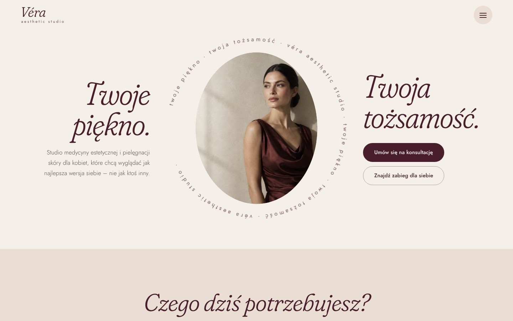

# VÉRA Aesthetic Studio – koncepcja 2 („Różany pokój”)

Druga, alternatywna koncepcja strony fikcyjnego studia VÉRA. Ta sama marka, te same treści i te same kolory co
w [koncepcji 1](../vera/README.md), ale zupełnie inny charakter: kobieca, miękka i skierowana bezpośrednio do kobiet.

> **Koncept demonstracyjny agencji ComputerIT.** Studio, zespół, adres, telefon, e-mail i Instagram są fikcyjne
> (placeholdery). Treści medyczne mają charakter poglądowy i przed publikacją wymagają weryfikacji przez personel
> medyczny. Strona nie obiecuje efektów i nie podaje certyfikatów ani kwalifikacji.



Podgląd online (statyczny, formularze nic nie wysyłają): https://claude.ai/artifact/Kteiu1XAXqZfrg3pRC4gj2 –
prywatny, udostępnia się go z menu „Share” na stronie.

## Uruchomienie

Najprościej: zainstaluj **Node.js LTS** (https://nodejs.org) i kliknij dwukrotnie w katalogu `vera-2/` plik
**`URUCHOM-WINDOWS.bat`** (Windows) albo **`URUCHOM-MAC.command`** (Mac). Strona otworzy się pod http://localhost:3000.

Z terminala:

```bash
cd vera-2
npm install
npm run dev
```

Kontrole jakości: `npm run lint && npm run typecheck && npm test && npm run build`.

## Czym różni się od koncepcji 1

| | Koncepcja 1 | Koncepcja 2 |
| --- | --- | --- |
| Charakter | edytorialny, surowy, asymetryczny | miękki, kobiecy, symetryczny |
| Kroje | Cormorant Garamond (wersaliki) + Manrope | Fraunces (miękka kursywa) + Jost (lekki) |
| Kształty | ostre kadry, linie, bez zaokrągleń | owale, kapsuły, duże zaokrąglenia, przyciski-pigułki |
| Proporcje kolorów | dużo burgundu i czerni | przewaga kości słoniowej i pudrowego różu, burgund jako akcent |
| Hero | nagłówek nachodzący na zdjęcie | owalny portret w obracającym się pierścieniu tekstu, hasło po obu stronach |
| Menu | panel z listą po lewej i zdjęciem po prawej | „kurtyna” z zaokrąglonym dołem, wyśrodkowane pozycje kursywą, mały owal ze zdjęciem przy wskazanej pozycji |
| Język | neutralny | zwraca się bezpośrednio do kobiet („Czego dziś potrzebujesz?”, „Zajrzyj do nas”) |

Nowe elementy, których nie ma w koncepcji 1:

- **„Czego dziś potrzebujesz?”** – wybór potrzeby (zmarszczki mimiczne, matowa skóra, dłonie, „nie wiem, od czego
  zacząć”…) pokazuje dopasowane zabiegi.
- **Filtr obszarów** na liście zabiegów (działa też z adresu, np. `/zabiegi#kosmetologia`).
- Strona zabiegu: owalne zdjęcie, kroki wizyty w kółkach, panele „Dla kogo” i „Kiedy nie”, kwalifikacja na
  burgundowej planszy.

Wspólne z koncepcją 1 (skopiowane, bez zmian w logice): dane zabiegów, zespołu i artykułów, formularze z walidacją
i Server Actions, wysyłka przez `FORMS_WEBHOOK_URL`, SEO (sitemap, robots, Open Graph, JSON-LD), adresy podstron,
zdjęcia (`src/config/images.ts`, uwagi o rozdzielczości w README koncepcji 1).

## System wizualny

| Token | Kolor | Zastosowanie |
| --- | --- | --- |
| Ivory | `#F4EFE8` | tło strony, karty |
| Blush | `#E9DDD4` | odcień pośredni ivory/powder – tła sekcji, pól, chipów |
| Powder beige | `#D8C5B8` | sekcje wyróżnione, przycisk menu |
| Burgundy | `#481E2C` | tekst, przyciski, menu, stopka |
| Muted rose | `#A98788` | linie, kropki, pierścień wokół portretów (2,8:1 – nie do drobnego tekstu) |
| Rose deep | `#7D5A5C` | drobny tekst w akcencie na jasnym tle |

Ruch: owal otwiera się przy wejściu na stronę, a napis wokół portretu powoli się obraca (wyłączone przy
`prefers-reduced-motion`). Pozostałe animacje odpowiadają na działania użytkownika.

## Testy (QA)

Na buildzie produkcyjnym (Chromium/Playwright): menu – 21 sprawdzeń (klawiatura, Escape, pułapka fokusu, blokada
przewijania, szybkie klikanie, zamykanie po nawigacji, wysokość panelu, reduced motion); formularze i galeria –
13 sprawdzeń; brak przewijania w poziomie na 360–1920 px; audyt axe-core (WCAG 2.1 AA) bez naruszeń.
