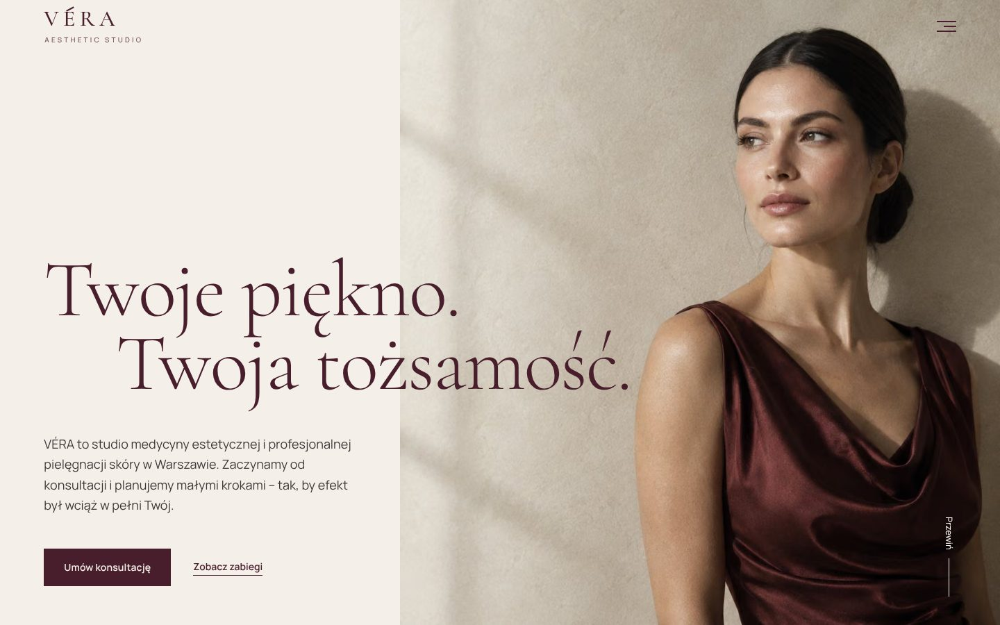

# VÉRA Aesthetic Studio – strona internetowa

Strona fikcyjnego studia medycyny estetycznej i profesjonalnej pielęgnacji skóry. Hasło marki: *Twoje piękno. Twoja tożsamość.* (z briefu: *Your beauty. Your identity.*)

> **Koncept demonstracyjny agencji ComputerIT.** Studio, zespół, adres, telefon, e-mail i Instagram są fikcyjne
> (placeholdery). Opisy zabiegów, wskazania i przeciwwskazania mają charakter poglądowy i przed publikacją wymagają
> weryfikacji przez personel medyczny. Strona nie obiecuje efektów i nie podaje certyfikatów ani kwalifikacji.



## Uruchomienie

Najprościej (bez terminala): zainstaluj **Node.js LTS** z https://nodejs.org, a potem kliknij dwukrotnie w katalogu
`vera/` plik **`URUCHOM-WINDOWS.bat`** (Windows) albo **`URUCHOM-MAC.command`** (Mac – za pierwszym razem: prawy
przycisk → Otwórz). Strona otworzy się pod adresem http://localhost:3000.

Z terminala:

```bash
cd vera
npm install
npm run dev            # http://localhost:3000
```

Kontrole jakości:

```bash
npm run lint && npm run typecheck && npm test && npm run build
```

## Stack

- **Next.js 16** (App Router, Turbopack, Server Actions), **React 19**, **TypeScript**
- **Tailwind CSS 4** – tokeny kolorów, typografii i komponentów w `src/app/globals.css`
- **next/font** – Cormorant Garamond (nagłówki) i Manrope (tekst, interfejs)
- **next/og** – grafika Open Graph generowana z krojów marki (`@fontsource`)
- **Vitest** – testy walidacji formularzy

Język strony: polski (treści, menu, formularze, komunikaty i adresy podstron).

## Podstrony

| Adres | Zawartość |
| --- | --- |
| `/` | hero kampanijne, filozofia, wybrane zabiegi, „Wizyta w VÉRA”, specjaliści, galeria z lightboxem, magazyn, kontakt |
| `/o-nas` | historia nazwy, podejście, „czego nie robimy”, przestrzeń studia |
| `/zabiegi` | cztery kategorie – każda z własnym układem (burgund + lista, tabela, kolumny zdjęć, oferta konsultacji) |
| `/zabiegi/[slug]` | 10 zabiegów: opis, przebieg konsultacji i wizyty, wskazania, przeciwwskazania, kwalifikacja, CTA |
| `/specjalisci` | trzy osoby (fikcyjne), naprzemienne portrety |
| `/magazyn`, `/magazyn/[slug]` | trzy artykuły |
| `/kontakt` | dane kontaktowe, godziny, formularz kontaktowy |
| `/konsultacja` | zapytanie o konsultację (zabieg można wybrać z adresu: `/konsultacja?zabieg=peeling-chemiczny`) |
| `/polityka-prywatnosci` | projekt polityki prywatności |

Do tego: strona 404, `sitemap.xml`, `robots.txt`, manifest, ikona, grafika Open Graph, dane strukturalne JSON-LD
(BeautySalon, BreadcrumbList, Article).

## Menu – element identyfikacji marki

`src/components/layout/SiteHeader.tsx` + sekcja „Navigation” w `src/app/globals.css`.

- W nagłówku tylko logo i przycisk z trzech poziomych kresek (środkowa krótsza; wydłuża się po najechaniu).
- Po kliknięciu burgundowy panel rozwija się od górnej krawędzi (`clip-path`), na desktopie ma ~84% wysokości
  ekranu, na telefonie pełną wysokość. Pozycje „01 — STRONA GŁÓWNA … 06 — KONTAKT” wysuwają się z masek z opóźnieniem (stagger),
  przycisk zamienia się w X, logo zostaje widoczne.
- Hover/fokus: pozostałe pozycje przygasają, wskazana przesuwa się, kreska się wydłuża, a po prawej (desktop)
  zmienia się podgląd zdjęcia docelowej podstrony.
- Na dole panelu: „Umów wizytę”, telefon, e-mail i Instagram (placeholdery).
- Dostępność: `aria-expanded`, `aria-controls`, zmienna etykieta przycisku, `aria-current` dla bieżącej strony,
  panel `inert` gdy zamknięty, fokus zamknięty w nagłówku, Escape zamyka i zwraca fokus do przycisku, kliknięcie
  w tło zamyka, blokada przewijania z kompensacją paska przewijania, `prefers-reduced-motion`.
- Animacje to przejścia CSS sterowane atrybutem `data-menu`, więc szybkie wielokrotne klikanie po prostu odwraca
  przejście – bez blokad i wyścigów stanów. Zmiana adresu (link, przycisk Wstecz) zamyka menu.

## System wizualny

| Token | Kolor | Zastosowanie |
| --- | --- | --- |
| Burgundy | `#481E2C` | menu, sekcje kontrastowe, przyciski, nagłówki |
| Ivory | `#F4EFE8` | tło strony |
| Powder beige | `#D8C5B8` | galeria, sekcja konsultacji |
| Deep black | `#171515` | tekst, sekcje kontrastowe, stopka |
| Muted rose | `#A98788` | linie, numeracja, duży tekst (2,8:1 na ivory – nie do drobnego tekstu) |
| Rose deep / rose light | `#7D5A5C` / `#C9A9A9` | drobny tekst w akcencie na ivory (5,3:1) / na burgundzie (6,5:1) |

Charakterystyczne elementy: nagłówki z przesuniętą drugą linią, akcent „É” w logotypie rysowany jako kreska,
przekrojony wielki logotyp w stopce. Ruch: jedna sekwencja wejścia w hero; pozostałe animacje odpowiadają na
działania użytkownika (menu, hover, lightbox).

## Podgląd online

Statyczny podgląd wszystkich podstron (bez serwera; formularze w podglądzie nie wysyłają danych):
https://claude.ai/artifact/WB9kntBJGvk4P5ftazTgbc – prywatny, udostępnia się go z menu „Share” na stronie.

## Zdjęcia

Lista wszystkich zdjęć z tekstami alternatywnymi i kadrowaniem: `src/config/images.ts`.

- **Od klienta:** gabinet zabiegowy, zabieg pielęgnacyjny (wycięty z kompozycji), dwa zdjęcia manicure.
- **Wygenerowane dla konceptu (Figma AI)** w spójnej stylistyce (burgund, ivory, światło dzienne, ziarno filmu).
  Plik Figma: https://www.figma.com/design/RU9DpQnwczVWqYFVUNGTwh

**Do zrobienia:** w pełnej rozdzielczości (1024 px) pobrane zostało tylko zdjęcie hero. Pozostałe 13 zdjęć
wygenerowanych (oznaczone `preview: true`) jest powiększonych z podglądów 256 px, bo limit wywołań Figma na planie
Starter wyczerpał się przed ich pobraniem. Żeby je wyostrzyć: w pliku Figma zaznacz ramkę o identyfikatorze z pola
`figmaNode`, wyeksportuj ją jako JPG i zapisz w `public/images/vera/` pod nazwą z pola `file` (np. `2:6` →
`specialist-physician.jpg`), następnie usuń `preview: true`. Zdjęcia osób są wygenerowane – to nie są prawdziwi
pracownicy studia.

## Formularze i rezerwacja

- Walidacja w przeglądarce (komunikaty przy polach, fokus na pierwszym błędzie) i ponownie w Server Actions.
  Bez JavaScriptu formularze nadal działają. Pole-pułapka na boty i limit prób.
- Zgłoszenia trafiają do `FORMS_WEBHOOK_URL` (JSON z typem `contact` / `consultation`).
  **Bez tej zmiennej formularz mówi wprost, że nic nie zostało wysłane**, i podaje telefon oraz e-mail.
- Strona nie udaje rezerwacji: formularz `/konsultacja` to zapytanie, studio oddzwania z terminem. Po ustawieniu
  `NEXT_PUBLIC_BOOKING_URL` pojawia się przycisk do zewnętrznego kalendarza (np. Booksy).

Zmienne środowiskowe: `.env.example`. Indeksowanie w wyszukiwarkach jest wyłączone, dopóki
`NEXT_PUBLIC_ALLOW_INDEXING` nie ma wartości `true`.

## Testy (QA)

Sprawdzone w Chromium (Playwright) na buildzie produkcyjnym:

- wszystkie podstrony zwracają 200 (404 dla nieistniejących), jeden `h1` na stronę, brak błędów w konsoli;
- menu: otwieranie z klawiatury, Escape, pułapka fokusu, blokada przewijania, szybkie wielokrotne klikanie,
  zamykanie po nawigacji, kliknięciu w tło i przycisku Wstecz, wysokość panelu (100% mobile, ~84% desktop),
  `prefers-reduced-motion`;
- formularze: błędy przy polach, fokus, data w przeszłości, wybór zabiegu z adresu, komunikat o braku integracji;
- galeria: lightbox, strzałki, Escape, powrót fokusu;
- brak przewijania w poziomie na 360, 390, 430, 768, 1024, 1440 i 1920 px;
- audyt axe-core (WCAG 2.1 AA) bez naruszeń.

## Struktura

```
src/
  app/                    podstrony, actions.ts (Server Actions), sitemap, robots, manifest, OG
  config/site.ts          ★ nazwa, kontakt (placeholdery), godziny, nawigacja
  config/images.ts        ★ zdjęcia: plik, alt, kadr, źródło
  data/treatments.ts      ★ kategorie i 10 zabiegów
  data/specialists.ts     zespół (osoby fikcyjne)
  data/journal.ts         artykuły
  data/gallery.ts         układ galerii
  lib/validation.ts       walidacja wspólna dla przeglądarki i serwera
  lib/server/             wysyłka webhookiem, limit prób
  components/             layout (nagłówek z menu, stopka), sekcje strony głównej, formularze, galeria, UI
public/images/vera/       zdjęcia
docs/screenshots/         zrzuty ekranu
```
