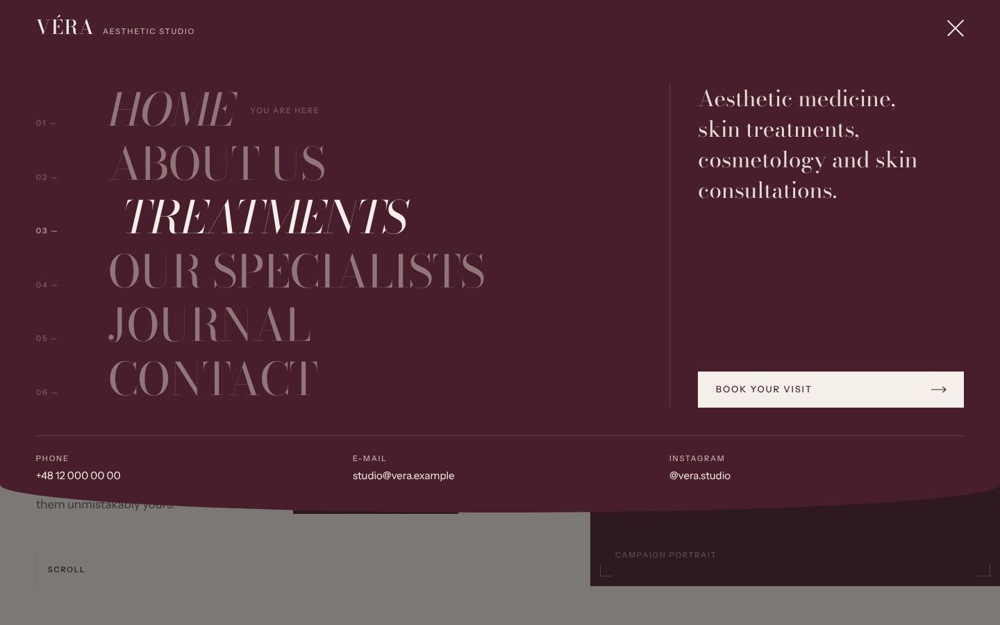

# VÉRA Aesthetic Studio – strona internetowa

Drugi koncept beauty w portfolio ComputerIT: studio medycyny estetycznej i pielęgnacji skóry w Krakowie (Kazimierz).
Hasło marki: *Your beauty. Your identity.* Strona jest w języku angielskim.

> **Koncept demonstracyjny ComputerIT.** Adres, telefon, e-mail, Instagram, specjaliści oraz opisy zabiegów są
> przykładowe. Treści medyczne wymagają weryfikacji przez specjalistów studia przed publikacją.



## Stack

- **Next.js 16** (App Router, Turbopack, Server Actions), **React 19**, **TypeScript**, **Tailwind CSS 4**
- **next/font** – Bodoni Moda (nagłówki, logotyp) i Instrument Sans (tekst, interfejs), serwowane z własnego serwera
- **next/og** – grafiki Open Graph i ikony generowane z krojów marki (`@fontsource`)
- **Vitest** – testy walidacji formularzy

## Uruchomienie

```bash
cd vera
npm install
npm run dev            # http://localhost:3000
npm run lint && npm run typecheck && npm test && npm run build
```

## Kierunek artystyczny

Projekt celowo odmienny od ÉLORIA (`../eloria`): inna typografia (didone zamiast Garamonda), kontrastowe sekcje
burgund / czerń / ivory, ostre prostokątne przyciski, układy magazynowe i duża skala typografii.

| Token | Kolor | Zastosowanie |
| --- | --- | --- |
| Burgundy | `#481E2C` | menu, sekcje kontrastowe, CTA |
| Ivory | `#F4EFE8` | tło |
| Powder Beige | `#D8C5B8` | sekcje specjalistów, kosmetologii |
| Deep Black | `#171515` | tekst, sekcje Experience, stopka |
| Muted Rose | `#A98788` | duże cyfry, logotyp w stopce (2,8:1 na ivory – nie do drobnego tekstu) |
| Rose deep / light | `#7A5758` / `#C9A9AA` | drobny tekst akcentowy na ivory / na burgundzie (≥ 4,5:1) |

## Menu (element charakterystyczny)

`src/components/layout/SiteHeader.tsx` + style `.menu-*` w `src/app/globals.css`.

- W nagłówku tylko logo i przycisk z trzema kreskami; po otwarciu kreski zamieniają się w X.
- Burgundowy panel zjeżdża od góry na pełną szerokość: ok. 82% wysokości na desktopie (dolna krawędź układa się
  w miękki łuk), 100% na telefonie. Logo i przycisk pozostają nad panelem.
- Pozycje 01–06 wchodzą ze staggerem; najechanie przesuwa pozycję, zmienia ją na kursywę i przygasza pozostałe,
  a kolumna obok pokazuje opis wskazanej sekcji. Na dole: telefon, e-mail, Instagram i „Book your visit”.
- Dostępność: `aria-expanded` / `aria-controls`, etykiety „Open menu” / „Close menu”, `inert` na treści strony
  (fokus nie wychodzi poza menu), Escape zamyka i przywraca fokus, blokada przewijania z kompensacją szerokości
  paska przewijania, zamknięcie po kliknięciu poza panelem, po nawigacji i po „Wstecz”, `prefers-reduced-motion`.
- Stan jest jednym `useState`, a animacje to przejścia CSS – szybkie wielokrotne klikanie po prostu odwraca przejście.

## Struktura

```
src/
  app/                    /, /about, /treatments, /treatments/[slug], /specialists, /journal, /journal/[slug],
                          /contact, /book (formularz w 3 krokach), /privacy, 404, sitemap, robots, manifest, OG, ikony
    actions.ts            Server Actions formularzy (walidacja, limit prób, pole-pułapka, webhook)
  config/site.ts          ★ dane studia, kontakt, pozycje menu
  config/images.ts        ★ shot list: plik → miejsce, alt, proporcje, brief dla fotografa, ton planszy
  data/treatments.ts      ★ 4 kategorie, 10 zabiegów (opis, przebieg, wskazania, przeciwwskazania, kwalifikacja)
  data/specialists.ts     specjaliści (osoby fikcyjne)
  data/journal.ts         artykuły Journal
  lib/validation.ts       walidacja wspólna dla przeglądarki i serwera
  components/             layout (menu), sekcje strony głównej, formularze, UI
public/images/vera/       zdjęcia
docs/screenshots/         zrzuty ekranu
```

Każda kategoria zabiegów ma własną prezentację na `/treatments`: lista na burgundzie (Aesthetic Medicine), tabela
porównawcza (Skin Treatments), dwa duże kadry (Professional Cosmetology), czarny blok „start here” (Skin Consultation).

## Zdjęcia

Sieć środowiska, w którym powstał projekt, blokowała banki zdjęć, więc w serwisie jest jedno zdjęcie dostarczone przez
klienta (niebo – artykuł „Daylight and your skin”, 259 × 194 px, pokazane w małej skali). Pozostałe miejsca mają w
`src/config/images.ts` brief zdjęciowy kampanii; do czasu sesji wyświetla się plansza w kolorze marki ze znacznikami
cięcia i nazwą kadru. Aby dodać zdjęcie, wgraj plik o nazwie z pola `file` do `public/images/vera/` i przebuduj projekt.

## Formularze i rezerwacja

- `/contact` – formularz kontaktowy; `/book` – zapytanie o konsultację w 3 krokach (zabieg → termin → dane)
  z walidacją każdego kroku i podsumowaniem. `/book?treatment=<slug>` wybiera zabieg (linki z podstron zabiegów).
- Bez JavaScriptu oba formularze działają (wszystkie kroki naraz, walidacja na serwerze).
- Zgłoszenia trafiają do `FORMS_WEBHOOK_URL`. **Bez niej formularz mówi wprost, że nic nie zostało wysłane.**
  Zapytanie nie jest rezerwacją – komunikat po wysłaniu to zaznacza. `NEXT_PUBLIC_BOOKING_URL` dodaje link do
  zewnętrznego kalendarza. Zmienne: `.env.example`.

## SEO i dostępność

Unikalne title/description i canonical, Open Graph z grafiką per zabieg, dane strukturalne (`MedicalClinic`,
`BreadcrumbList`, `Article`), sitemap (22 adresy), robots, manifest. Do czasu `NEXT_PUBLIC_ALLOW_INDEXING=true`
strona ma `noindex`. Kontrast WCAG 2.1 AA (sprawdzony axe-core), skip link, zakładki specjalistów w modelu WAI-ARIA
(strzałki), filtry `aria-pressed`, przewijana galeria dostępna z klawiatury.

## Przed publikacją

- [ ] Dane studia i administratora – `src/config/site.ts`, pola „to be completed” w `/privacy`.
- [ ] Weryfikacja opisów zabiegów i artykułów przez specjalistów; prawdziwy zespół (z numerem PWZ lekarza).
- [ ] Sesja zdjęciowa według briefów z `src/config/images.ts`.
- [ ] `FORMS_WEBHOOK_URL` (+ lista odbiorców danych w polityce prywatności), opcjonalnie `NEXT_PUBLIC_BOOKING_URL`,
      `NEXT_PUBLIC_INSTAGRAM_URL`, `NEXT_PUBLIC_SITE_URL`, `NEXT_PUBLIC_ALLOW_INDEXING=true`.
